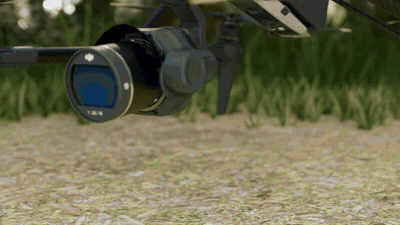

# Woodland Drone Showcase

一个 20 秒的林间无人机 CG 展示：精细机体、尾部跟拍、前向机载画面与同步几何点云。
这是第三版成片的开源代码和复现资料，尚未加入障碍识别或自主避障。

A Blender showcase with a detailed drone appearance, a procedural woodland,
aircraft-tail tracking, a forward mounted camera and synchronized geometric scans.

## Video

https://github.com/user-attachments/assets/99135268-3d27-48e1-aa20-cdbaef172e9d

The inline player uses a compact 720p copy of the complete 20-second video.

[Download the original 20-second, 1080p/30 fps MP4](https://github.com/Ekko82/woodland-drone-showcase/releases/download/v0.3.0/inspire3-woodland-20s.mp4)
· [Release and portable scenes](https://github.com/Ekko82/woodland-drone-showcase/releases/tag/v0.3.0)



| Time | Main view |
|---|---|
| 0–6 s | Optical detail, aircraft reveal and takeoff |
| 6–8 s | Aircraft-tail tracking with cloud inset |
| 8–10 s | Forward mounted RGB camera with cloud inset |
| 10–14 s | Aircraft-tail tracking with cloud inset |
| 14–16 s | Cloud view with external camera inset |
| 16–20 s | Rear-side camera orbit around a held recorded pose |

## What is simulated

The video replays an existing **PX4/Gazebo X500** pose recording with an Inspire 3
appearance. The takeoff and cruise windows use nonuniform time compression. The
last four seconds hold one recorded pose while the external camera orbits.
The source contains sideways and backward flight; the follow camera stays on
the aircraft's body-tail side rather than switching sides with its velocity.

The forward sensor and the visible optical assembly share the same direction:
model-local **−Y forward, +Z up**, with the optics pitched 6° downward. Blender's
camera looks along its local −Z axis. Geometry scans use that same mounted camera,
not an independently reversed camera.

The cloud contains **47,386 accumulated surface points** from **26 batches**.
Each batch casts a jittered 112 × 64 ray grid into the rendered woodland meshes,
with an 18 m maximum range and 7 cm voxel deduplication. This is ideal geometric
sampling of known CG surfaces. It is not a LiDAR hardware model, SLAM output,
learned obstacle recognition or a collision-avoidance result. Normal maps affect
shading, and the infinite HDRI background does not contribute scan points.

This version demonstrates rendering and sensor alignment. It does not validate
DJI dynamics, real flight, physical sensor performance or autonomous navigation.

## Quick reproduction from the release scenes

Use **Blender 4.5 LTS**, Python 3.10+ and FFmpeg with libx264 and AAC. The original
production video used Blender 4.5.14, Cycles, 48 samples and OptiX. The portable
renderer chooses an available Cycles device and uses OpenImageDenoise; different
devices/versions can produce different pixels while preserving the scene/timeline.

1. Clone this repository and install the host Python dependencies:

   ```sh
   git clone https://github.com/Ekko82/woodland-drone-showcase.git
   cd woodland-drone-showcase
   python -m pip install -r requirements.txt
   ```

2. Download `portable-scenes.zip` from the release and extract its contents into
   `build/`. It includes packed image assets, both scenes and the numeric inputs.
   Read `THIRD_PARTY.md` before redistributing those assets.

3. Verify the scene, render and compose:

   ```sh
   blender --background --python-exit-code 1 --python scripts/check_scene.py
   blender --background --python-exit-code 1 --python scripts/render_video.py -- --backend AUTO
   blender --background --python-exit-code 1 --python scripts/render_cloud.py
   python scripts/compose_video.py --crf 17
   ```

The result is `build/inspire3-woodland-20s.mp4`. Rendering can resume because existing
frame files are skipped. For a quick camera preview, render one frame at reduced
resolution into a separate output directory to avoid mixing preview/full frames.
To use a different output directory, set `SHOWCASE_OUTPUT` before running the scripts.
Pass `--blender` to the build script or `--ffmpeg` to the compositor when the tools
are not on `PATH`.

## Build the scene from code

1. Download the **original GLB** from the credited model page. Put exactly one GLB
   into `assets/source/`. The rig expects the checksum in `assets/model-source.json`;
   a converted export or different node names will not match this measured rig.
2. Fetch the selected CC0 assets, then build:

   ```sh
   python scripts/fetch_textures.py
   python scripts/build.py --blender blender
   blender --background --python-exit-code 1 --python scripts/check_scene.py
   ```

The build imports and normalizes the model, creates the woodland and body animation,
calibrates the physical/virtual optics, applies summer ground materials, adds actual
understory meshes, rescans those final surfaces, applies lighting and the rear
camera, packs textures, and builds the cloud scene. No raw flight simulator rerun
is required; `data/animation-data.json` supplies the resampled 600-frame input.
Restarting the full build starts from a fresh model import. `--from-stage` can resume
a failed stage when its previous outputs still exist.

For a detailed CPU audit of scan visibility and replay against the final scene:

```sh
blender --background --python-exit-code 1 --python scripts/verify_direction.py
```

This audit can require substantial RAM because it builds BVHs over the complete
environment. Its JSON output separates original sampling replay from rendered
geometry coverage and rounded-endpoint reprojection.

## Repository contents

| Path | Contents |
|---|---|
| `scripts/` | Model import, forest generation, optics calibration, camera animation, scans, render and composition |
| `data/` | Resampled poses, sensor configuration, rig measurements and point cloud |
| `assets/` | Selected source/author/license/checksum manifests |
| `docs/` | Production verification and reproduction checks |
| `media/` | Small animated preview and cover |
| Release | Original MP4 and packed editable scenes, kept outside Git history |

## License and credits

Original project code and numeric inputs: [MIT](LICENSE).
Rendered media and composed scenes: CC BY 4.0 with the full credits in
[THIRD_PARTY.md](THIRD_PARTY.md).

“DJI Inspire 3” model by [polyman Studio](https://sketchfab.com/Polyman_3D),
[CC BY 4.0](https://creativecommons.org/licenses/by/4.0/),
[source model](https://sketchfab.com/3d-models/dji-inspire-3-158e4fa0710f4511be14b73374b5df9b).
Model materials, alignment, optical pitch, rotor rig and animation were changed
for this showcase. It is a third-party model with no official DJI affiliation.
Textures and HDRI: [Poly Haven](https://polyhaven.com/license), CC0.
